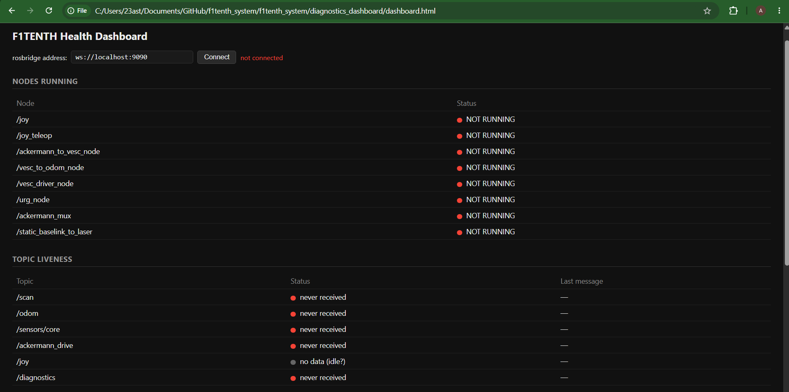

# Alexander Stapp's Engineering Log

## Week 2
* **Monday 8/31/2026**
  * Created individual engineering log files for team progress reporting.
  * Worked on drafting an ADR
  * Researched benefits of using a web application for the diagnostics system. And updated the ADR to reflect the research.

* **Wednesday 9/2/2026**
  * Reviewed subsystem-inventory md
  * Did research into creating a web interface that can connect to the robo-racer car and provide live updates and statuses of the nodes.

I also created a prototype Health Dashboard that uses `rosbridge_websocket` node that opens on `localhost:9000`. This allows a webpage to be created that can communicate with ROS using JSON

The site uses simple HTML with JS using the `roslibjs` library to connect to the websocket. This allows us to access nodes such as `/diagnostics`, `/joy`, `/scan`, and `/odom`

  

In order to connect to the robot using the site, you would need to ssh into the robot, and then in the site add the rosbridge address to connect.