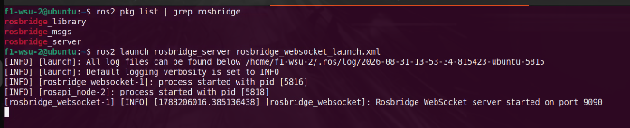
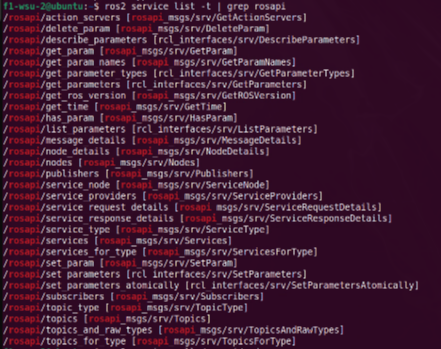

# Luke's Engineering Log

## Week 2
* **Monday 8/31/2026**
  * Researched how to read node, topic, and sensor health out of ROS 2 so we can design the diagnostics tool based on what ROS 2 gives us.
  * Established that the text scrolling in the robot's terminal is only log output - the actual data (steering, speed, laser, battery) travels over DDS on topics. So the tool has to join the ROS graph and subscribe as its own node, not scrape the terminal.
  * Found that ROS already covers most of the collection side: `diagnostic_msgs`, `diagnostic_updater`, and `diagnostic_aggregator`. `ackermann_mux` and `urg_node` already publish to `/diagnostics`. Leaning toward extending the existing stack rather than building our own from scratch.
  * Identified `rosbridge_server` as the way to get data into a web page. It exposes ROS over a WebSocket on port 9090 as plain JSON, so the browser needs no ROS install. It is already declared as a dependency in `f1tenth_stack/package.xml`, but nothing currently launches it.
  * Worked out how to distinguish "node running but publishing nothing" from "node not running" - the publisher count on a topic combined with whether messages actually arrive.
  * Noted the useful sensor data lives on `/sensors/core` (battery voltage, motor and FET temperature, VESC fault codes) and `/scan` for the lidar.
  * On the robot: confirmed rosbridge is installed and starts correctly, and confirmed the `rosapi` services are available for querying nodes and topics from a browser.
  * Started stepping through the available commands to verify what data we actually get back, but the robot's WiFi began timing out with roughly 90% packet loss, so live testing stopped there. Picking this back up next session.

### Evidence

`rosbridge_server` is installed on the robot and the WebSocket server comes up on port 9090:

With rosbridge running, the `rosapi` services become available. These are what let a
browser ask which nodes are alive (`/rosapi/nodes`), what topics exist and their types
(`/rosapi/topics`), and who publishes a given topic (`/rosapi/publishers`) - the last one
being how we tell a crashed node from a hung one:

