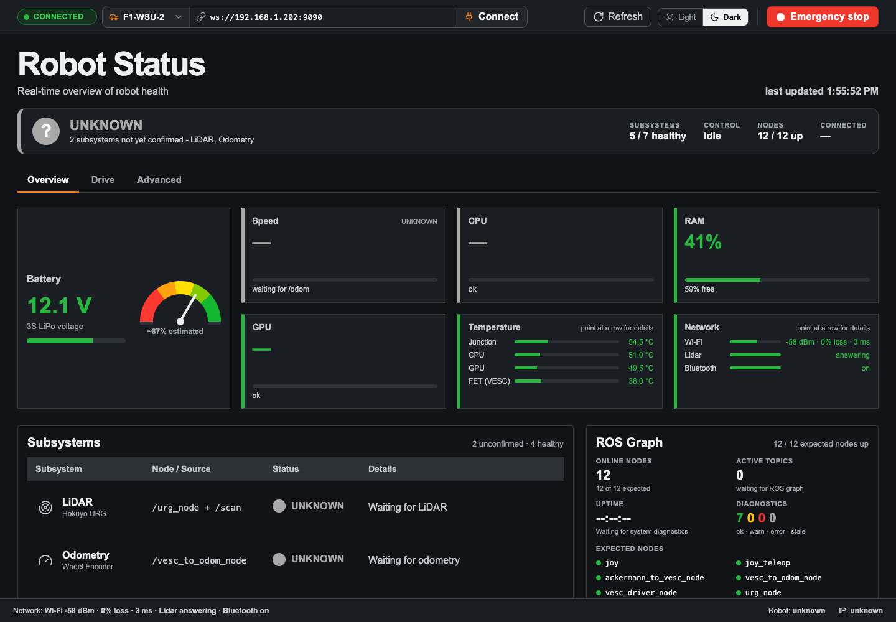

# Robot Diagnostics

A live health dashboard for the Weber State University **RoboRacer** (F1TENTH) cars. It runs on the car and shows, in any browser on the same Wi-Fi, whether the car is ready to drive and what is wrong when it is not: ROS nodes and topics, battery, computer temperatures and load, network and LiDAR, camera, controller, and every subsystem's health. It can also drive the car, with an emergency stop that works for everyone.



## Quick start

**On a car** (the normal way). Copy the dashboard to the car once, then start it:

```bash
rsync -av ~/Desktop/robot-diagnostics/prototype/ f1-wsu-2@192.168.1.202:~/diag/
ssh f1-wsu-2@192.168.1.202 '~/diag/start_diagnostics.sh'
```

Then open `http://192.168.1.202:8000/dashboard.html`. Cars are F1-WSU-1 to F1-WSU-12 at `192.168.1.201` to `.212`; pick one from the robot list in the dashboard's top bar.

**From your laptop, against a car**, without copying anything (handy while changing the page):

```bash
cd prototype
python3 -m http.server 8000
# open http://localhost:8000/dashboard.html?url=ws://192.168.1.202:9090
```

**Checks with no robot:** `node prototype/tests/run.mjs` runs every logic check and prints PASS or FAIL for each.

The full guide to running it, every check it makes, and which file to change for each is **[docs/system-overview.md](docs/system-overview.md)**.

## Where things live

| Folder | What is in it |
|---|---|
| [`prototype/`](prototype/) | **The dashboard.** The page (`dashboard.html`, `css/`, `js/`), the robot-side services (`system_diagnostics.py`, `camera_http.py`), the start script, tools for checking a car, and `tests/`. Its [README](prototype/README.md) maps every file |
| [`docs/`](docs/) | How it works and why: the system overview, design docs, decisions (ADRs), research, sprint reviews. Its [README](docs/README.md) is an index |
| [`diagnostic-hardware/`](diagnostic-hardware/) | The physical indicator: the PCB hat's Gerbers, EasyEDA project and layouts |
| [`Engineering_Logs/`](Engineering_Logs/) | Each team member's log |
| [`Images/`](Images/) | Screenshots used by the README and the logs |

The dashboard grew out of the ROS status prototype, which is why it lives in `prototype/`. That folder is the working dashboard.

## Why this exists

When a RoboRacer misbehaves, the cause can be anywhere: a ROS node that did not start, a flat battery, a lost Wi-Fi link, an unplugged LiDAR, a controller that will not pair. Finding it meant checking each part separately, by hand. This project brings all of it onto one screen, so anyone using the cars (students in labs, instructors setting them up, anyone developing on them) knows where to start.

Each subsystem reports one of four states: **Healthy**, **Degraded**, **Failed** or **Unknown**. Unknown means the dashboard cannot tell yet (for example, nothing has reported); it does not mean failed.

## Working on it

- Each part of the page has its own files: see [prototype/README.md](prototype/README.md) for the scripts and [prototype/css/README.md](prototype/css/README.md) for the styles.
- Run `node prototype/tests/run.mjs` before opening a pull request. Pull requests run it automatically too.
- Record a decision that is hard to reverse as an ADR in [`docs/adr/`](docs/adr/).
- New documents go in the matching folder in `docs/`, with lowercase-dash names, and a line in [docs/README.md](docs/README.md).
