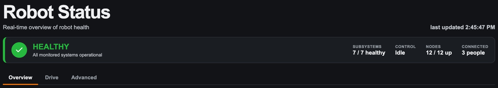
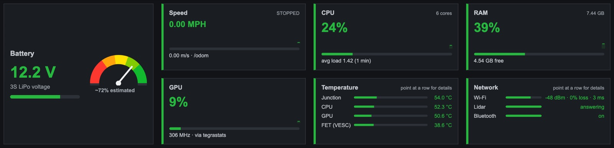
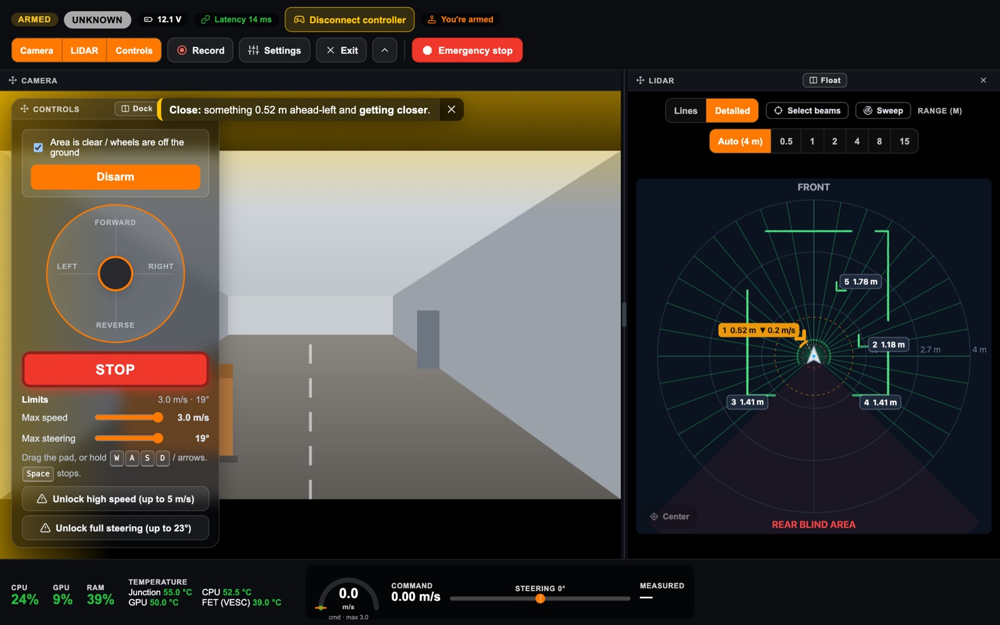
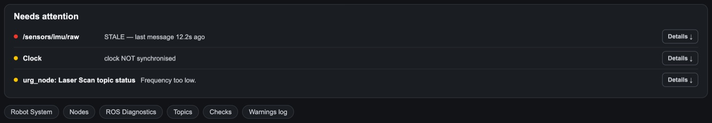
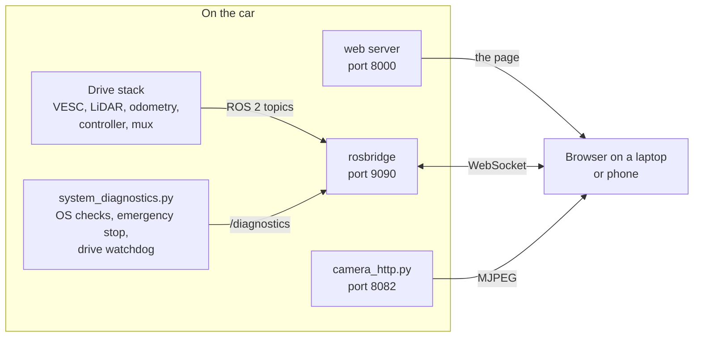

# Robot Diagnostics

A live health dashboard for Weber State University's **RoboRacer** (F1TENTH) cars. It runs on the car and opens in any browser on the same Wi-Fi, laptop or phone. In one screen it answers **"can I drive?"** and, when the answer is no, **"what is wrong?"**. It can also drive the car, with an emergency stop that works for everyone.



| Overview | Drive | Advanced |
|---|---|---|
| [](docs/guides/overview-tab.md) | [](docs/guides/drive-tab.md) | [](docs/guides/advanced-tab.md) |
| Battery, computer, subsystems, ROS graph, camera, LiDAR | Drive from the browser: camera, LiDAR radar, keys or thumb sticks | Every warning, worst first, and the detail behind it |

## Why it exists

When a RoboRacer misbehaves, the cause can be anywhere: a ROS node that did not start, a flat battery, a lost Wi-Fi link, an unplugged LiDAR, a controller that will not pair. Finding it meant checking each part by hand, in a terminal. The dashboard brings all of it onto one screen, graded in plain colours, so anyone using the cars (students in labs, instructors setting them up, developers testing code) knows where to start.

Every part of the car reports one of four states: **Healthy**, **Degraded**, **Failed** or **Unknown**. Unknown means the dashboard cannot tell yet; it never means failed.

## What it does

- **Status at a glance.** One verdict for the whole car, which names what is wrong: *DEGRADED — LiDAR, Battery*.
- **Battery** voltage and an estimate of what is left, judged on lines agreed with the course instructor.
- **The robot's computer:** CPU, RAM, GPU, temperatures, Wi-Fi quality, the LiDAR's cable and Bluetooth.
- **Subsystems:** controller, motor controller (VESC), LiDAR, odometry, camera and control mode, each with what is wrong in words and often how to fix it.
- **ROS graph:** which of the 12 expected nodes run and whether the key topics are flowing. Topics that only publish while someone drives are not flagged as broken at rest.
- **Live camera and LiDAR.** The LiDAR has a radar view that tags the nearest objects and says when something is getting closer.
- **Driving** from the browser, with a dead-man, speed and steering limits, edge warning lights, a full-screen first-person view, and thumb sticks on a phone. The physical controller always has priority.
- **Autonomous runs** from the page: a set speed and steering (or full speed), started with a button or by holding R1 on the controller, with an indicator and a Stop for anything autonomous on the car.
- **Obstacle stop:** while anything drives the car forward through `/drive`, the car watches its LiDAR ahead and stops itself before it hits something.
- **Emergency stop** for everyone: this page, other dashboards, the controller and autonomous code.
- **Troubleshooting tools:** a "Needs attention" list, every raw reading from the car's own checks, live topic messages, a joystick check, and the ROS warning log.
- **Controller tab:** a PS4 controller drawn live from `/joy`, with what is pressed lit up, the sticks and triggers moving, and the deadman buttons checked.
- **Robot picker** for F1-WSU-1 to F1-WSU-12, phone layout, and light and dark modes.

## Quick start

### Open it

With the dashboard running on a car, open this from any device on the lab Wi-Fi:

```
http://192.168.1.202:8000/dashboard.html
```

Each car is at `192.168.1.200` plus its number: F1-WSU-1 is `.201`, F1-WSU-12 is `.212`. You can switch cars from the robot list in the page's top bar.

### Start it on a car

Copy the dashboard to the car once, then start it:

```bash
rsync -av ~/Desktop/robot-diagnostics/prototype/ f1-wsu-2@192.168.1.202:~/diag/
ssh f1-wsu-2@192.168.1.202
cd ~/diag && ./start_diagnostics.sh     # bringup, checks, rosbridge, web server, camera
```

`./start_diagnostics.sh --status` shows what is up and `--stop` stops it; `--help` lists the rest. On cars where the dashboard is part of bringup (`f1tenth_stack`), plain `bringup` starts it too. Both ways are in [docs/system-overview.md](docs/system-overview.md#running-it).

### Work on it from a laptop

No copying needed. Serve the page locally and point it at a running car:

```bash
cd prototype
python3 -m http.server 8000
# open http://localhost:8000/dashboard.html?url=ws://192.168.1.202:9090
```

### Run the checks

No robot needed:

```bash
node prototype/tests/run.mjs
```

It prints PASS or FAIL for each check: the LiDAR geometry, beam selection, the system list and banners (against the page's real code), and the self-tests of the two robot-side services.

## How it works



- The car serves a **plain web page**: HTML, CSS and JavaScript, no build step, no internet needed.
- The page talks to ROS through **rosbridge**, so the laptop or phone needs nothing installed.
- **`system_diagnostics.py`** reports what ROS does not know about (temperatures, memory, Wi-Fi, USB devices, the clock) as a normal ROS node on `/diagnostics`. It also runs the emergency stop and the drive watchdog.
- **`camera_http.py`** relays the camera to browsers, always sending the newest frame, so a weak link drops frames rather than falling behind.

Why each piece is built this way, and which file to change for each check, is in [docs/system-overview.md](docs/system-overview.md).

## Documentation

| Read this | To |
|---|---|
| [Overview guide](docs/guides/overview-tab.md) | Read the first page: every card, colour and threshold |
| [Drive guide](docs/guides/drive-tab.md) | Drive a car from the dashboard safely |
| [Advanced guide](docs/guides/advanced-tab.md) | Find out why something is wrong |
| [Controller guide](docs/guides/controller-tab.md) | See live what the car hears from the PS4 controller |
| [System overview](docs/system-overview.md) | Understand how it works, run it, and change any check |
| [Drive control design](docs/design/dashboard-drive-control.md) | See how a command gets from the browser to the motors, and every safety rule |
| [Emergency stop design](docs/design/emergency-stop.md) | See what the emergency stop does on the car |
| [docs/README.md](docs/README.md) | Browse everything else: decisions (ADRs), research, sprint reviews |

## Where things live

| Folder | What is in it |
|---|---|
| [`prototype/`](prototype/) | **The dashboard.** The page (`dashboard.html`, `css/`, `js/`), the robot-side services (`system_diagnostics.py`, `camera_http.py`), the start script, tools for checking a car, and `tests/`. Its [README](prototype/README.md) maps every file |
| [`docs/`](docs/) | User guides, the system overview, design docs, decisions (ADRs), research, sprint reviews. Its [README](docs/README.md) is the index |
| [`diagnostic-hardware/`](diagnostic-hardware/) | The physical indicator: the PCB hat's Gerbers, EasyEDA project and layouts |
| [`Engineering_Logs/`](Engineering_Logs/) | Team members' engineering logs |
| [`Images/`](Images/) | Screenshots used in the logs and earlier docs |
| [`.github/`](.github/) | The checks every pull request runs, and the pull request template |

The dashboard grew out of the ROS status prototype, which is why it lives in `prototype/`. That folder is the working dashboard.

## Requirements

- **On the car:** ROS 2 Humble with the F1TENTH stack, `rosbridge_server`, Python 3, and GStreamer for the camera. `start_diagnostics.sh` starts everything.
- **To view it:** any modern browser on the same network. Nothing to install.
- **To run the checks:** Node.js (the pull request checks use Node 20) and Python 3. No robot, ROS or browser needed.

## Contributing

- **Find the right file first.** [prototype/README.md](prototype/README.md) maps the scripts, and [prototype/css/README.md](prototype/css/README.md) maps the styles. Every threshold and the robot list are in `prototype/js/config.js`.
- **Run `node prototype/tests/run.mjs`** before opening a pull request. Pull requests run it automatically, along with a check that every link in the docs works.
- **Changed what the page looks like?** Update the matching guide in [`docs/guides/`](docs/guides/) and its screenshots.
- **Made a decision that is hard to reverse?** Record it as an ADR in [`docs/adr/`](docs/adr/).
- **New documents** go in the matching folder in `docs/`, with lowercase-dash names and a line in [docs/README.md](docs/README.md).

## Contributors

- Saman Chapagain
- Luke Peterson
- Darrin Bracken
- Alex Stapp

Weber State University. Engineering logs are in [`Engineering_Logs/`](Engineering_Logs/).
